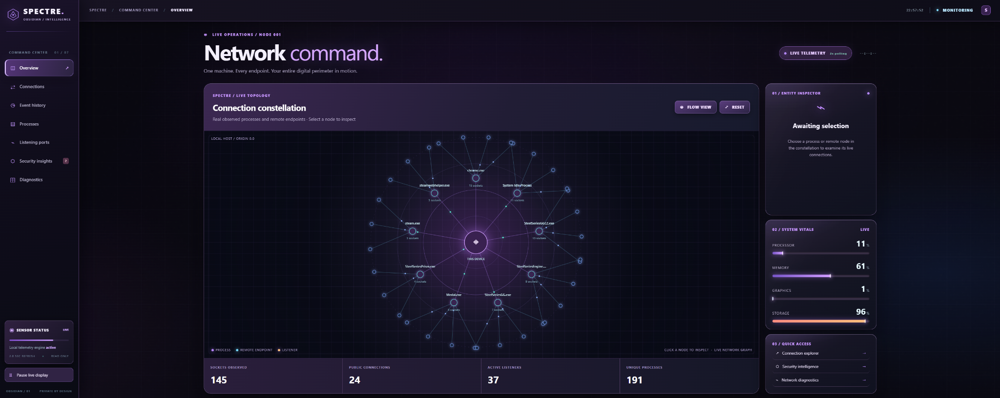
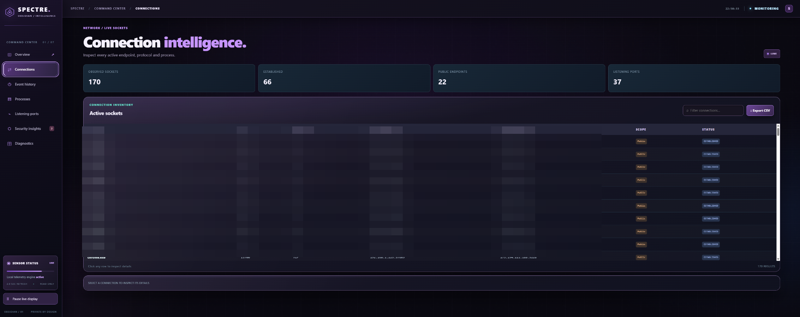
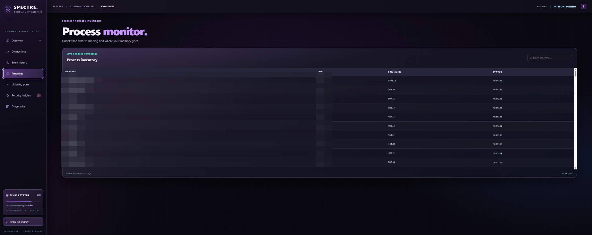
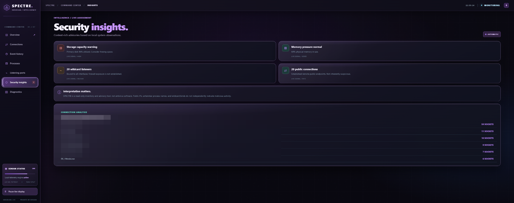
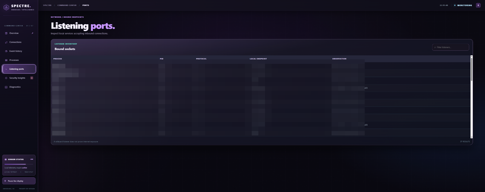
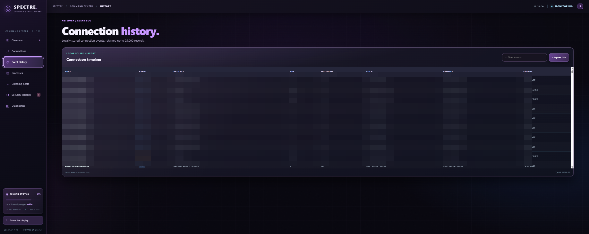
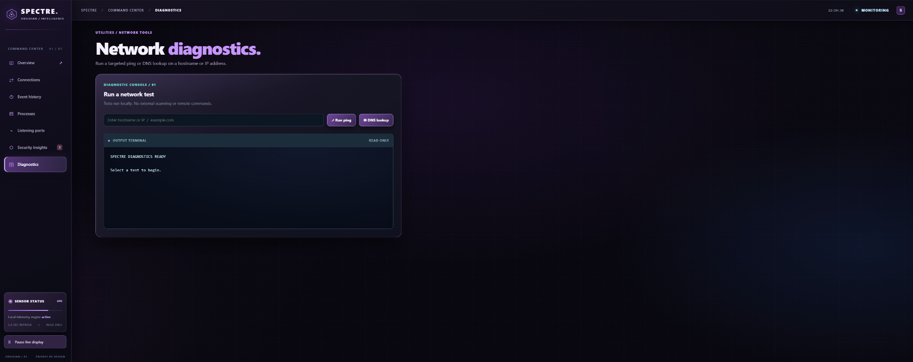

# 👻 SPECTRE // OBSIDIAN

### Network Intelligence. Reimagined.

**A modern, open-source Windows desktop application for real-time network intelligence, system monitoring, and diagnostics.**

---

## Overview

**SPECTRE // OBSIDIAN** transforms complex system and network activity into an interactive monitoring experience.

Explore active network connections, identify running processes, monitor hardware performance, and investigate network behavior through a modern desktop interface.

Built for users who want greater visibility into what happens beneath the surface of their computers.

## Features

### Interactive Network Constellation

Explore a visual representation of your computer's network activity.

- Interactive process and endpoint nodes
- Live network connection visualization
- Clickable nodes with connection details
- Process identification and socket information

## 📸 Screenshots

### Network Command Center
Explore your network through SPECTRE's interactive connection constellation.

### Connection Intelligence
Monitor active TCP/UDP connections, processes, and remote endpoints.

### Process Monitor
Inspect running processes and their memory usage.

### Security Insights
View automated observations about your system's activity.

### Listening Ports
Identify local services accepting incoming connections.

### Connection History
Explore locally recorded connection events.

### Network Diagnostics
Run ping tests and DNS lookups.

---

### Real-Time System Monitoring

Monitor your computer's performance through live telemetry.

- CPU utilization
- RAM usage
- NVIDIA GPU telemetry on supported hardware
- Storage utilization
- Upload and download speeds
- Live performance charts

### Network Intelligence

Inspect your system's active network connections.

- TCP and UDP monitoring
- Process and PID identification
- Local and remote endpoint information
- Searchable connection tables
- Connection history
- CSV exports

### Security Insights

Receive automated observations about your system and network.

- Public connection visibility
- Listening-port monitoring
- Resource usage warnings
- Process activity summaries
- Informational security advisories

### Network Diagnostics

Investigate network connectivity using built-in tools.

- Ping testing
- DNS lookups
- Diagnostic output

---

## Download & Installation

### Windows

**[Download the latest SPECTRE release](https://github.com/Planet9y/SPECTRE-Obsidian/releases/latest)**

1. Open the latest release.
2. Download `SPECTRE.exe` under **Assets**.
3. Launch the application.
4. Explore your network and system activity.

**Requirements**
- Windows 10/11 (64-bit)
- Compatible NVIDIA GPU and drivers for optional NVIDIA GPU monitoring

The packaged Windows executable does not require a separate Python installation.

---

## Technology

SPECTRE is developed using:

- Python
- PySide6 / Qt WebEngine
- HTML, CSS, and JavaScript
- psutil
- SQLite

## Privacy & Security

SPECTRE is designed for local monitoring.

- No external account required
- Local monitoring and interface communication
- Connection history stored locally
- Read-only monitoring functionality
- No cloud service required

SPECTRE is an informational monitoring and diagnostic application, **not an antivirus or intrusion prevention system**.

Security advisories are observations and should not automatically be interpreted as evidence of malicious activity.

## Open Source

SPECTRE // OBSIDIAN is released under the **MIT License**.

You may use, modify, and distribute the software under the terms of that license.

See [LICENSE](LICENSE) for details.

---

### Developed by Planet9y

**SPECTRE // OBSIDIAN**

*See beyond the surface.*

[Download SPECTRE](https://github.com/Planet9y/SPECTRE-Obsidian/releases/latest) | [View Releases](https://github.com/Planet9y/SPECTRE-Obsidian/releases) | [Report an Issue](https://github.com/Planet9y/SPECTRE-Obsidian/issues)
